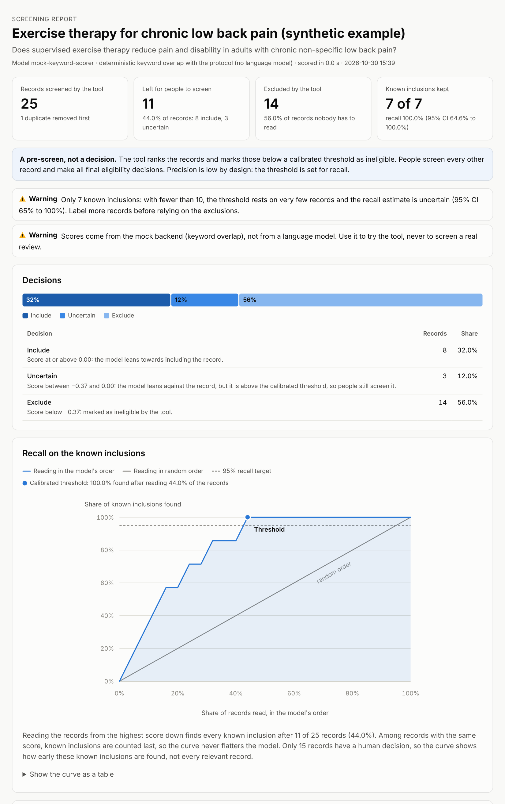
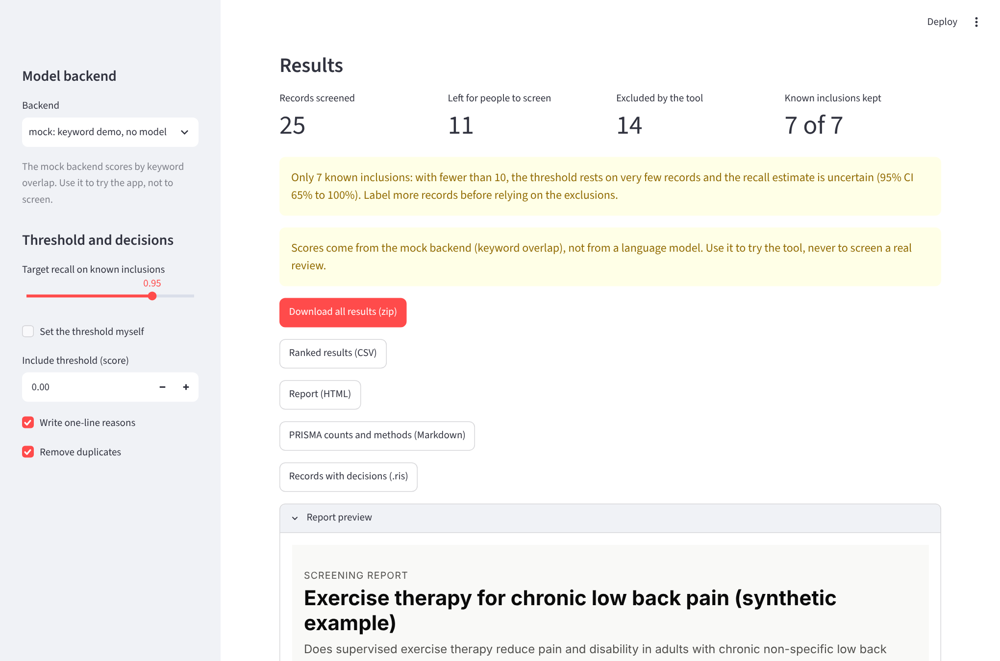

# llm-literature-screener

Reviewers of a systematic review read thousands of titles and abstracts to find a few dozen
relevant studies. `llm-literature-screener` pre-screens them with an open LLM: for every
record the model reads the review question, the eligibility criteria, the title and the
abstract, and the logits of its Yes/No answer give a score. A threshold calibrated on
records your team has already screened keeps a target share (for example 95%) of the known
inclusions, and only the records below it are set aside. Everything else goes to people, who
make every final decision. The tool reads RIS, PubMed, CSV, TSV, Excel, Rayyan and Covidence
files, writes the same formats back, and produces PRISMA 2020 counts, a methods paragraph
and a self-contained HTML report.



*The report for the bundled synthetic example, screened with the mock backend (keyword
overlap, no model). The numbers show how the report works, not how well a model screens.*

## Features

- **Validated scoring.** logit(Yes) - logit(No) of the first answer token, with the prompt of
  the validated case study; no text is generated for scoring.
- **Recall-first calibration.** The threshold is the highest score that keeps the target
  recall of your known inclusions, reported with a Wilson confidence interval; there is a
  warning when fewer than 10 inclusions are known.
- **Three decisions.** Include, uncertain (above the threshold, but the model leans against)
  and exclude.
- **Your formats in and out.** RIS, PubMed MEDLINE (.nbib), CSV, TSV, Excel with column
  mapping, Rayyan and Covidence exports; each written back with score, P(include), decision
  and reason added.
- **Duplicate removal** by DOI, PMID, and normalized title plus year, with a report of every
  merge, also across several input files.
- **Three backends.** Hugging Face transformers (bf16 on GPU, length-sorted batches by token
  budget), any OpenAI-compatible server (vLLM, llama.cpp, Ollama), and a deterministic mock
  for tests and demos.
- **Optional one-line reasons**, generated only for the records people will read.
- **Reporting.** PRISMA 2020 counts, a methods paragraph, and an HTML report that loads
  nothing from the internet.
- **Evaluation.** ROC AUC, WSS@95, recall curve, workload saved, precision and Cohen's kappa
  against human decisions.
- **Command line (`lls`) and a web app** (Streamlit), a CPU Docker image, type hints
  throughout, and a test suite run in CI on Python 3.10 to 3.12.

## How it works

1. The model reads the question, the criteria, the title and the abstract (cut to 350 words)
   and is asked whether the record should go to full-text review.
2. score = logit(Yes) - logit(No) for the first answer token; P(include) = sigmoid(score).
3. The threshold is set on records your team has already screened: the highest score that
   keeps the target share of the known inclusions.
4. Records below the threshold are excluded; the rest are marked include or uncertain and
   go to people.

The method comes from a
[case study](https://github.com/Hedmm/ml-case-studies/tree/main/llm-screening-systematic-reviews)
with Qwen2.5-7B-Instruct, zero-shot, on three published medical reviews (19,425 records).
With the threshold set on one review and applied unchanged to the other two, it kept 88 of
92 final inclusions on those two test reviews while 67% of their records did not need to be
read. See the case study for the full results and their limits.

## Installation

Python 3.10 or later:

```bash
git clone https://github.com/Hedmm/llm-literature-screener.git
cd llm-literature-screener
python3 -m venv .venv
source .venv/bin/activate
pip install -e .
```

Optional extras: `pip install -e ".[hf]"` for local models (PyTorch and transformers),
`pip install -e ".[ui]"` for the web app, and `pip install -e ".[dev]"` for the tests,
ruff and mypy. A CPU Docker image is described in the [usage guide](docs/usage.md#8-docker).

## Quickstart (two minutes)

After the installation above, screen the bundled synthetic example with the mock backend,
which needs no model:

```bash
lls screen --records examples/records.ris --criteria examples/protocol.yaml --labels examples/labels.csv --backend mock --reasons --out results/
```

The run removes one duplicate, scores the 25 remaining records, calibrates the threshold on
the 15 labeled ones and prints a summary:

```text
┌─────────────────────────────┬──────────────────────────────────────────┐
│ Records identified          │                                       26 │
│ Duplicates removed          │                                        1 │
│ Excluded by the tool        │                                       14 │
│ Left for people to screen   │              11 (8 include, 3 uncertain) │
│ Exclusion threshold (score) │                                   -0.374 │
│ Known inclusions kept       │ 7 of 7 = 100.0% (95% CI 64.6% to 100.0%) │
└─────────────────────────────┴──────────────────────────────────────────┘
```

It also warns that 7 known inclusions are too few for a reliable threshold, and that mock
scores do not come from a language model. Open `results/report.html` in a browser. The
`results/` folder also holds the ranked `screening_results.csv`, the records back in RIS
with the decisions added (`records_screened.ris`), the PRISMA counts and methods paragraph
(`prisma.md`), and the duplicate report.

To screen with a real model, install the `hf` extra and drop `--backend mock`. The default
model, `Qwen/Qwen2.5-7B-Instruct`, is practical only on a GPU; the `openai` backend can use
a model served on another machine.

## Command line

| Command | What it does |
|---|---|
| `lls screen` | Deduplicate, score, calibrate, decide; write results, PRISMA counts and the report. |
| `lls calibrate` | Recompute the threshold on saved scores and show what other recall targets would cost. |
| `lls evaluate` | Benchmark against a fully labeled set: ROC AUC, WSS@95, recall, workload, kappa. |
| `lls report` | Rebuild the HTML report from saved results, optionally with new labels or thresholds. |
| `lls ui` | Start the web app. |

```bash
# Screen with a local model on a GPU, keeping 95% of the known inclusions
lls screen --records refs.ris --criteria protocol.yaml --backend hf \
  --model Qwen/Qwen2.5-7B-Instruct --labels seed.csv --target-recall 0.95 --out results/

# Combine database exports and use a vLLM server
lls screen --records pubmed.nbib --records embase.ris --criteria protocol.yaml \
  --labels seed.csv --backend openai --model Qwen/Qwen2.5-7B-Instruct \
  --base-url http://localhost:8000/v1 --out results/

# After labeling more records: new threshold and report, without running the model again
lls calibrate results/ --labels more_labels.csv
lls report results/ --labels more_labels.csv --out results/report_v2.html

# Evaluate on a fully labeled review with a threshold set on another review
lls evaluate --records test_review.csv --criteria test.yaml --dev-scores dev/ --out evaluation/
```

Every command has `--help` with examples. The [usage guide](docs/usage.md) covers the
protocol file, the labels file, the backends and all outputs.

## Web app

```bash
pip install -e ".[ui]"
lls ui
```

Upload the records, paste or upload the protocol, add known decisions, choose a backend,
run with a progress bar, and download the results and the report.



## Benchmark

`benchmarks/synergy.py` downloads the three SYNERGY reviews of the case study, calibrates the
threshold on Appenzeller-Herzog_2020 and applies it to Wolters_2018 and van_Dis_2020:

```bash
pip install -e ".[hf]"
python benchmarks/synergy.py
```

The validated numbers are in the
[case study](https://github.com/Hedmm/ml-case-studies/tree/main/llm-screening-systematic-reviews).
Options, outputs and the differences from the case study code are described in
[benchmarks/README.md](benchmarks/README.md).

## Documentation

- [Usage guide](docs/usage.md): inputs, backends, outputs, recalibration, evaluation, web
  app, Docker and the Python API.
- [File formats](docs/file-formats.md): what is read from each format and what is written
  back.
- [Calibration](docs/calibration.md): the score, the threshold rule, Wilson intervals and the
  evaluation metrics.
- [Limitations](docs/limitations.md): read before using the tool in a review.

## Limitations in brief

This is a pre-screen. People screen every record above the threshold and make all final
decisions. Precision is low by design, because the threshold is set for recall, and the
recall estimate is only as good as the known decisions it rests on. The method was validated
on three medical reviews with one model. See [limitations](docs/limitations.md).

## Development

```bash
pip install -e ".[dev]"
pytest
ruff check . && ruff format --check .
mypy
```

The tests use small synthetic files for every format and the mock backend. Tests that need
PyTorch build tiny random models offline; one downloads a tiny model and is skipped when it
cannot.

## License

MIT, see [LICENSE](LICENSE). The SYNERGY datasets used by the benchmark keep their own
licenses.
